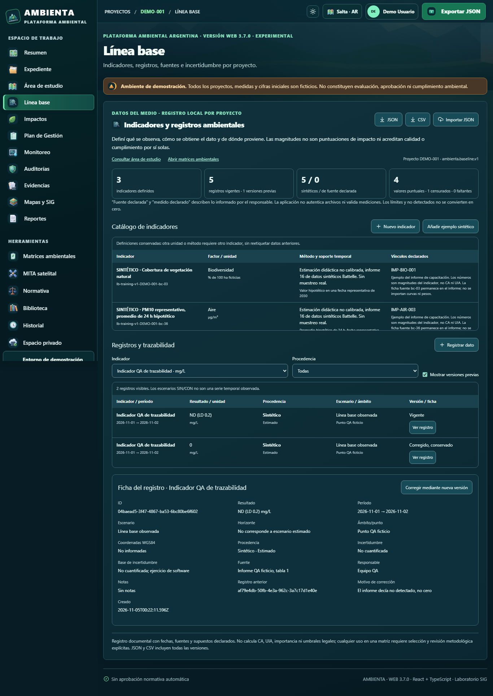

# Línea base e indicadores — primera entrega

Fecha de trabajo: 2026-11-04/05. Rama: `feature/linea-base-indicadores-2026-11-04`.
Base: `495b306277d6d8c301e456bcdffbabe492144a78`, rama Battelle del PR #86. Main continúa en `841f1356f86a3561be70fb0d3c7ce961a8d3640b`. Este cambio es dependiente de #86 y #85; no se publica ni se fusiona por separado.

## Alcance autorizado

El siguiente paso del diagnóstico metodológico es documentar las magnitudes ambientales antes de utilizarlas en las matrices. Se incorpora `/linea-base` a la navegación V3 y un enlace desde la ayuda del constructor. Se conservan los cálculos aprobados de Leopold, Conesa y Battelle, V1/V2, sus identificadores y sus almacenamientos. No se desarrolla en esta entrega el comparador de alternativas ni Vj/valoración total de Conesa.

No es una nueva fórmula del libro ni una evaluación ambiental. Es un registro documental: fuente declarada no significa autenticada, medido declarado no significa verificado y un vínculo a un impacto no prueba causalidad. No hay índices, conversiones de unidades, interpolación, umbrales normativos ni transferencia automática a matrices.

## Funciones disponibles

- Catálogo inmutable de definiciones: nombre, factor, unidad, método, soporte temporal, alcance y vínculos opcionales a impactos existentes. Cambiar unidad o método requiere otro indicador, conservando los datos originales. Las unidades distinguen mayúsculas.
- Registros por indicador con período (precisión día), ámbito/punto, coordenadas WGS84 opcionales emparejadas, procedencia sintética o de fuente declarada, medido/estimado, escenario, horizonte, fuente/localizador, responsable, incertidumbre y notas.
- Resultado numérico finito (incluido cero), menor que, mayor que, no detectado con LD positivo o dato faltante justificado. ND/faltantes nunca reciben un cero implícito. El LD no se usa como valor ambiental puntual.
- Correcciones por nueva versión, con motivo, conservando la anterior; cadena sin ciclos, bifurcaciones, huérfanos o cambio de indicador/procedencia. Definiciones y registros no se eliminan desde la interfaz.
- Catálogo, filtros, fichas enlazables por URL y consulta de versiones previas; resumen de registros vigentes, valores puntuales, censurados y faltantes. No se representan escenarios como si fueran una serie temporal observada.
- Guardado local por proyecto: `ambienta-baseline-v1:<projectId>`, esquema `ambienta.baseline.v1`. Abrir la página no escribe datos. Otro proyecto no reutiliza el estado de React ni sus registros.
- JSON íntegro con todas las versiones; CSV con metadatos, calificadores, LD, fuente, incertidumbre y estado de versión. CSV protegido frente a fórmulas de planilla. La importación agrega por ID, es idempotente y rechaza conflictos sin sobrescribir historia.
- Archivo dañado: bloqueo de edición, descarga literal del original y restauración explícita con respaldo local del original. Fallo de cuota: advertencia persistente y exportación del trabajo en memoria. Pestaña desactualizada: rechaza el guardado si otra pestaña cambió el archivo; se debe exportar y recargar. No es una base de datos transaccional multiusuario.

## Demos y datos

Botón optativo «Añadir ejemplo sintético», sin carga automática: DEMO-001 reutiliza vegetación y PM10 del informe 16; DIAB-2026-DEMO reutiliza pH y TDS. Son dos indicadores y cuatro registros SIN/CON por proyecto. Se reutilizan exclusivamente magnitudes y fuentes del paquete didáctico versionado; no se importan curvas ni UIP. Fecha representativa 2030-01-15 añadida explícitamente para el ejercicio; no corresponde a una campaña. No hay coordenadas inventadas ni afirmaciones de mediciones reales sobre Diablillos.

La prueba crea además un indicador QA ficticio, guarda cero y lo corrige a ND con LD 0,2. Resultado: 3 indicadores, 5 registros vigentes y 1 versión anterior, todos conservados en JSON/CSV. Estos datos no modifican las demos originales.

## Resultados locales

| Comprobación | Estado | Evidencia |
|---|---|---|
| Compilación TypeScript y Vite | PASS | `npm run build --prefix apps/web-v3` |
| Pruebas unitarias completas | PASS | 245/245; incluye 11 pruebas nuevas de contratos y regresión |
| DEMO-001 y DIAB-2026-DEMO, 1366/1800 | PASS | `baseline-smoke.mjs`, cuatro combinaciones, navegador limpio |
| Alta, validación, cero, ND/LD, corrección e historia | PASS | Registros originales conservados y contadores contrastados |
| Recarga y ficha enlazada | PASS | Recargas reales y URL de registro |
| Descargas reales | PASS | 8 archivos JSON/CSV descargados y leídos; 2 respaldos adicionales |
| Importación idempotente y rechazo de conflictos/proyecto ajeno | PASS | Sin modificación de almacenamiento previo |
| Cuota agotada y archivo dañado | PASS | Aviso, descarga y restauración con respaldo |
| Pestaña desactualizada | PASS | No sobrescribe cambios de otra pestaña |
| Navegación e ilustraciones de 17 secciones | PASS | `icon-coverage-smoke.mjs`, 1366/1800 |
| Revisión visual | PASS | Capturas completas, formularios y fichas abiertas a 1366/1800 |
| CI completo del código final | PASS | [Run 41941675120](https://github.com/insideah64-lab/ambienta-web/actions/runs/41941675120), SHA `ee003f74de7f34b658e2c77a832e17a0ff243d2b` |
| GitHub Pages con este módulo | NOT_RUN | Sin despliegue; se conserva HOLD previo |
| Histórico encabezado Leopold / pez azul | BLOCKED | No reproducidos en el diagnóstico anterior; esta entrega no atribuye ni cierra sus causas |
| Alternativas, Vj/valoración total, medidas y PVA ampliados | NOT_RUN | Siguientes entregas, fuera de este módulo |

Las advertencias previas de recursos CSS no resueltos y tamaño del bundle continúan en el build; no son errores TypeScript. No se consumieron créditos TinyFish ni vidIQ.

## Reproducción y archivos

1. Ejecutar el staging habitual `bash v3/scripts/build-v3.sh` en Linux/CI.
2. `node --test tests/react-v3/*.test.mjs`.
3. Servir `dist` en 127.0.0.1:8787 y ejecutar `node apps/web-v3/scripts/baseline-smoke.mjs`.
4. Abrir `http://127.0.0.1:8787/v3/index.html#/linea-base`; para Diablillos agregar `?caso=diablillos` antes del hash.
5. Revisar `qa/ambienta-baseline/results.json`, los JSON/CSV descargados y las 16 capturas `*-full.png`, `*-form-full.png`, `*-form.png`, `*-detail.png`.

Código canónico: `v3/overrides/src/features/baseline/`. Contratos: `BaselineModel.ts`; ejemplos: `BaselineTraining.ts`; interfaz: `BaselinePanel.tsx` y CSS. Regresión unitaria: `tests/react-v3/baseline.test.mjs`. CI añade `baseline-smoke.mjs` y conserva los otros 47 scripts de navegador y los hashes V1/V2. Las capturas y descargas se adjuntan al artefacto `ambienta-matrices-handoff-qa`.

Pendiente funcional posterior: selección explícita y revisada de registros para comparaciones entre alternativas; no crear esa transferencia ni cerrar discrepancias metodológicas pendientes sin documentarlas primero.

## Commits de esta entrega

- `2b7f1a44cb91b88b28c6ebc0c47a1a282afe7736`: módulo, navegación, contratos, ejemplos, regresiones y CI.
- `3241fedaf22fc1bf1118c3c61cb9cb90fe0f6e01`: errores del formulario actualizados al editar y visibles al guardar.
- `9d7a0542adc2b152eed18bba126efc1d40a3831f`: rechazo seguro de enumeraciones de tipo incorrecto en JSON.
- `ee003f74de7f34b658e2c77a832e17a0ff243d2b`: resumen de iconografía informa los 17 destinos efectivamente medidos.

[PR #87](https://github.com/insideah64-lab/ambienta-web/pull/87), borrador dependiente de #86. Los registros de demo, las fórmulas de las matrices y V1/V2 no cambian.

## Capturas permanentes del repositorio

Copias JPEG de las capturas PNG reales, sin redimensionar, abiertas y revisadas después de convertirlas. Los PNG íntegros de ambas demos y sus fichas quedan en el artefacto y en el paquete local. Las fichas usan únicamente datos ficticios de QA.

[Vista completa 1366 px](linea-base-capturas/DEMO-001-1366-full.jpg) · [Vista completa 1800 px](linea-base-capturas/DEMO-001-1800-full.jpg)

[Formulario en escritorio 1366 px](linea-base-capturas/DEMO-001-1366-form.jpg) · [Formulario en escritorio 1800 px](linea-base-capturas/DEMO-001-1800-form.jpg)

## Regresión adicional de matrices

PASS local a 1366/1800: `demo-project-matrices-smoke.mjs` sobre el registro importado de la demo, con Leopold −7/5, Conesa F1 −34, F2 1.000 UIP, F3a 0,8 / 0,5 / −0,3 y F3b 0,4 / 1 / +0,6. En esta prueba se importan once factores del registro, por lo que el contador correcto es 1/11; no se confunde con el control histórico de siete factores. Recargas y exportaciones verificadas, datos originales byte a byte idénticos. Una evaluación ambiental de la demo completa continúa BLOCKED por ausencia de mediciones y juicios técnicos reales.

El paquete local `AMBIENTA_LineaBase_Pruebas_y_Datos.zip` contiene 27 archivos, incluidos 16 PNG, 8 descargas JSON/CSV, los respaldos deliberados de QA y `results.json`, más un manifiesto SHA-256 contrastado con los contenidos del ZIP. No es un informe ambiental de campo ni debe importarse como dato real.

## Cierre de CI y publicación

[CI 41941675120 — SUCCESS](https://github.com/insideah64-lab/ambienta-web/actions/runs/41941675120) verifica el código final `ee003f74de7f34b658e2c77a832e17a0ff243d2b`: 245 pruebas unitarias, 48 scripts de navegador, diagnóstico P0 y conservación de hashes V1/V2. Build y carga de todos los artefactos satisfactorios.

[Artefacto completo de matrices y línea base](https://github.com/insideah64-lab/ambienta-web/actions/runs/41941675120/artifacts/13375884373), ID `13375884373`, digest `sha256:24ee8b872c078c156c8177ced485f97de2829ce93375b67e8e6b66e6de93ebf4`. Retención de CI: 30 días. Las cuatro capturas enlazadas arriba son archivos versionados del repositorio y no dependen de esa retención. El commit documental posterior solo añade este cierre y esas imágenes, sin cambios al código validado; cualquier ejecución posterior de CI queda visible en el PR.

No se fusionó ni desplegó. Se mantiene el HOLD heredado: diagnóstico histórico del encabezado Leopold y pez azul no reproducido, pendientes metodológicos de Conesa ya documentados y cadena de PR #85 → #86 → #87. Se puede revisar la nueva sección en el build local, manteniendo intacta la publicación actual.
