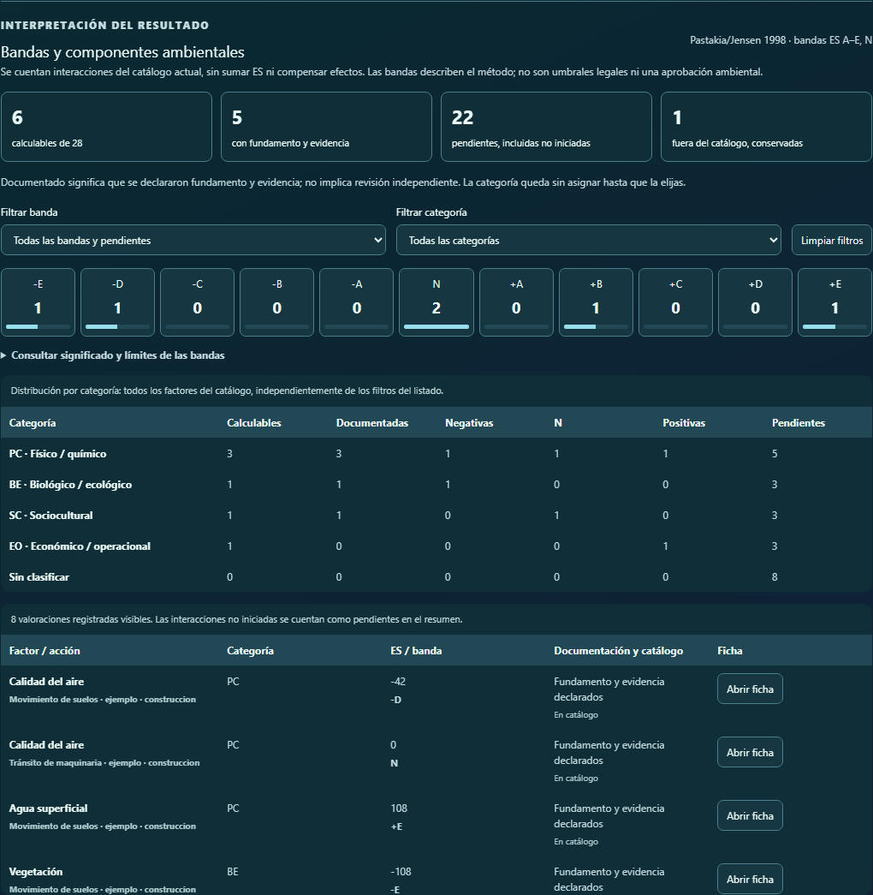

# RIAM — bandas, categorías y conservación de valoraciones

Fecha local: 2026-11-05. Rama nueva: `feature/riam-interpretacion-2026-11-04`.
Base validada: `c3c22e1dd56672f1f2f2ba447ee3cdd17c40a8ec` (PR #87). Main verificado: `841f1356f86a3561be70fb0d3c7ce961a8d3640b`. Entrega dependiente de #87, #86 y #85; no se fusiona ni despliega automáticamente.

## Alcance metodológico

Se completa la interpretación de RIAM antes de desarrollar el comparador de alternativas. La fórmula existente `ES = (A1 × A2) × (B1 + B2 + B3)` y todos sus valores permitidos permanecen iguales. `assess` y los criterios de Conesa conservan su cálculo. No se trasladan puntuaciones de Leopold, Conesa o Battelle.

Referencias: Pastakia y Jensen (1998), https://doi.org/10.1016/S0195-9255(98)00018-3 ; Kuitunen, Jalava y Hirvonen (2008), https://doi.org/10.1016/j.eiar.2007.06.004 , tablas de criterios y bandas en pp. 315–316. La segunda fuente es una aplicación de investigación con definiciones operativas, no una autorización para modificar el perfil original. El libro de Conesa revisado no desarrolla RIAM. Los videos encontrados se registraron como material didáctico: sus transcripciones y reproducción completa no pudieron validarse, por lo que no fundamentan cambios de puntuación.

Bandas según |ES|: A=1–9, B=10–18, C=19–35, D=36–71, E=72–108; se conserva el signo y cero corresponde a N. Una valoración incompleta no recibe banda. Son categorías metodológicas, no umbrales regulatorios argentinos. N requiere interpretar el contexto: A1=0 o A2=0 no son equivalentes a una interacción sin evaluar.

Se precisan únicamente rótulos y ayudas: A1=3 regional/nacional; B1/B2/B3=1 sin cambio/no aplicable; B3=3 acumulativo/sinérgico. Se explica que permanencia, reversibilidad y acumulación no son atributos intercambiables. Los valores históricos no se reescriben al abrir la herramienta.

## Implementación

- ES y banda visibles en cada celda calculable y en su ficha, con texto legible y signo explícito.
- Categorías PC (físico/químico), BE (biológico/ecológico), SC (sociocultural), EO (económico/operacional), asignadas manualmente por factor. No se infieren del nombre ni modifican el catálogo compartido.
- Distribución de cantidades en once bandas y tabla por categoría; no se suman ES ni se compensan efectos. Valores directos visibles y controles de teclado; tablas HTML semánticas dentro del componente Lumen Table.
- Contadores separados: calculables, con fundamento y evidencia declarados, pendientes incluidas las no iniciadas y registros fuera del catálogo. «Documentado» no significa revisado ni aprobado.
- Registros fuera del catálogo permanecen visibles y se exportan; no entran en la distribución del catálogo actual. Filtros de banda y categoría solo afectan el listado, no los totales, tal como indica la pantalla.
- Estado compartible: `metodo=riam-1998`, `riam-banda` y `riam-categoria` en el hash de la URL. Recarga, enlace directo, atrás/adelante y limpieza de filtros comprobados.
- JSON conserva esquema y entradas originales y agrega `riamInterpretation` con versión, fuentes, categorías, resultados, bandas, contadores y estado del almacenamiento. CSV conserva las columnas existentes y agrega identificadores, categoría, banda, documentación y pertenencia al catálogo. Incluye entradas huérfanas y protege campos frente a fórmulas de planilla.

## Persistencia y protección

La valoración mantiene su clave `ambienta-scored-matrix-v1:<proyecto>:riam-1998` y esquema `ambienta.scored-matrix.v1`. Las categorías usan otra clave: `ambienta-riam-interpretation-v1:<proyecto>`, esquema `ambienta.riam-interpretation.v1`. Asignar una categoría no reescribe los criterios ni el archivo de valoraciones.

Se guarda un respaldo literal de la valoración existente antes de la primera edición de cada sesión montada del editor, y de la clasificación anterior antes de cambiarla. Son respaldos locales por sesión/operación, no un historial transaccional completo de cada pulsación. Se conserva el respaldo aunque se recargue. El JSON exportado durante la sesión puede incluir `previousDocument`; después de recargar, el respaldo sigue en su clave local. No se ofrece eliminar valoraciones desde el editor RIAM.

Archivo RIAM dañado: edición y exportación calculada bloqueadas; descarga literal del original. Categorías dañadas: edición bloqueada, original conservado y exportado como `metadataRaw` con estado `invalid-preserved`. Cuota agotada: se avisa del trabajo en memoria, que queda exportable con su estado; si no puede preservarse el respaldo de una valoración existente, no comienza la edición. Pestañas desactualizadas no sobrescriben el archivo nuevo de otra pestaña. Esto no convierte localStorage en una base de datos transaccional multiusuario.

## Integración de interfaz y costo

Lumen React 4.3.0 incorporado solo a V3, con contrato y versiones contrastadas mediante el plugin. Se utilizan Badge y Table; la hoja de estilo se importa una vez en `main.tsx`, con tokens semánticos locales para RIAM. Se mantiene React 19 y la arquitectura existente. Context7 consultado para derivar resúmenes desde el estado actual y evitar copias que puedan desincronizarse.

Una vista de distribución DOM, dos tablas y filtros; sin librería adicional de gráficos, WebGL, animación ni red para calcular. La vista se actualiza al editar criterios o categorías. Se conserva la tabla como lectura accesible y exportable. Objetivo PC a 1366/1800 px; teléfono fuera del alcance indicado por el usuario.

Build local aproximado tras Lumen: CSS 611 kB (112 kB gzip), JS 2.081 MB (621 kB gzip). Aumento aproximado frente a la base: 218 kB CSS y 19 kB JS sin comprimir. La importación CSS es global V3; por ello se ejecutan también las regresiones del constructor, catálogo, páginas y los hashes V1/V2. Las advertencias previas de recursos CSS y tamaño de bundle continúan; no son errores TypeScript.

## Resultados en el corte local

| Comprobación | Estado | Evidencia |
|---|---|---|
| TypeScript y Vite | PASS | Build local completo |
| Pruebas unitarias completas | PASS | 255/255; 10 nuevas para límites de bandas, fuentes, categorías, pendientes, huérfanos y exportaciones |
| DEMO-001 y DIAB-2026-DEMO a 1366/1800 | PASS | Cuatro combinaciones, Chromium limpio |
| Interpretación y contadores | PASS | 6 calculables de 28, 5 documentadas, 22 pendientes y 1 huérfana; cinco asignaciones explícitas a cuatro categorías |
| Valoraciones históricas al clasificar | PASS | Archivo de puntuaciones byte a byte idéntico |
| Edición y respaldo | PASS | −48/−D pasa a −42/−D, respaldo literal conservado; cero N e incompleto pendiente diferenciados |
| Recargas, enlaces y navegación atrás/adelante | PASS | Estado de filtros y categorías recuperado |
| Descargas reales | PASS | 12 JSON/CSV descargados y leídos; además respaldos y exportaciones de control |
| Archivo dañado, categorías dañadas, cuota y pestañas | PASS | Sin sobrescritura del original; estados explícitos y exportables |
| Constructor y archivos Conesa anteriores | PASS | `matrix-workspace-smoke.mjs` y `matrix-method-catalog-smoke.mjs` |
| Revisión visual de escritorio | PASS | Capturas completas, fichas y distribución abiertas; tablas ocupan el ancho y ES/banda se separan |
| CI remoto de esta entrega | PASS | Ejecución 41965074633; código e420cfb20d43ccab76b301d54d41b8897736e120; build, 255 pruebas unitarias, batería de navegador, P0 y hashes V1/V2 |
| Operación mediante teclado | PASS | Selector de categoría PC, filtro +E y limpieza mediante teclado; puntuaciones sin cambios |
| Publicación GitHub Pages | NOT_RUN | HOLD heredado, sin despliegue |
| Incidencias históricas de encabezado Leopold/pez azul | BLOCKED | No reproducidas en P0; no se atribuyen ni cierran en esta entrega |
| Comparador de alternativas y conexión revisada con línea base | NOT_RUN | Siguiente entrega; no se simula con una suma de ES |
| Historial transaccional por cada modificación | NOT_RUN | Respaldos locales presentes; historial completo pendiente |

Los datos y clasificaciones de la regresión son juicios sintéticos de QA sobre el catálogo de ejemplo, no una evaluación ambiental de Diablillos ni de otro proyecto. No se inventan mediciones ni se certifica cumplimiento. No se consumieron créditos de TinyFish o vidIQ.

## Reproducción y continuidad

Código: `v3/overrides/src/features/impacts/RiamInterpretationModel.ts`, `RiamInterpretation.tsx`, CSS e integración en `MatrixMethodHub.tsx`. Regresión: `tests/react-v3/riam-interpretation.test.mjs`, `v3/overrides/scripts/riam-interpretation-smoke.mjs`.

1. Staging habitual: `bash v3/scripts/build-v3.sh` (Linux/CI).
2. `node --test tests/react-v3/*.test.mjs`.
3. Servir `dist` en 127.0.0.1:8787 y ejecutar `node apps/web-v3/scripts/riam-interpretation-smoke.mjs`.
4. Abrir `http://127.0.0.1:8787/v3/index.html#/matrices?metodo=riam-1998`; Diablillos usa `?caso=diablillos` antes del hash.
5. Resultados, 12 capturas y archivos descargados: `qa/ambienta-riam/`. Se incluyen en `ambienta-matrices-handoff-qa` con retención de 30 días. Se conserva la batería completa de 49 scripts del workflow y los hashes V1/V2.

Pendientes: comparador con componentes y horizonte comunes, selección explícita de fuentes de línea base y trazabilidad más detallada. Se mantiene la cadena de PR y el HOLD de publicación anterior.

## Commit y capturas permanentes

Código de esta entrega: `dcccf73a9f73f1d89a28ca218a009f5e8198b10e`. [PR #88](https://github.com/insideah64-lab/ambienta-web/pull/88), con base en la rama del PR #87. El cierre documental posterior incorpora la evidencia de CI y las cuatro imágenes siguientes.

[Vista completa 1366 px](riam-capturas/DEMO-001-1366-full.jpg) · [Vista completa 1800 px](riam-capturas/DEMO-001-1800-full.jpg)

[Interpretación ampliada 1366 px](riam-capturas/DEMO-001-1366-interpretation.jpg) · [Interpretación ampliada 1800 px](riam-capturas/DEMO-001-1800-interpretation.jpg)

Son copias JPEG de los PNG reales sin redimensionar, abiertas y revisadas después de convertirlas. Se conserva el conjunto de 12 PNG de ambas demos en el artefacto y en el paquete local `AMBIENTA_RIAM_Pruebas_y_Descargas.zip`: 28 archivos de QA más un manifiesto SHA-256 contrastado con el ZIP. Los archivos de control dañados son intencionales y no deben importarse como evaluaciones.

## Ajuste del diagnóstico P0

La primera ejecución remota [41964134313](https://github.com/insideah64-lab/ambienta-web/actions/runs/41964134313) quedó FAIL en el recorrido de P0 después de que RIAM y línea base pasaran. El recorrido suponía que una recarga siempre volvía a Leopold; ahora el método se conserva en la URL. Commit `e420cfb20d43ccab76b301d54d41b8897736e120`: se comprueba que Conesa sigue seleccionado tras recargar y se vuelve explícitamente a Leopold antes de medir el encabezado. No se elimina ninguna comprobación de geometría, zoom, consola, recursos ni navegación. P0 local repetido: PASS a 1366/1800, sin errores de página ni peticiones fallidas.

## Cierre de CI y publicación

[CI 41965074633 — SUCCESS](https://github.com/insideah64-lab/ambienta-web/actions/runs/41965074633) valida el código final `e420cfb20d43ccab76b301d54d41b8897736e120`: build completo, 255 pruebas unitarias, batería de 49 comandos de scripts de navegador, diagnóstico P0 y hashes V1/V2. Todos los pasos y cargas de artefactos finalizaron satisfactoriamente.

[Artefacto de matrices, línea base y RIAM](https://github.com/insideah64-lab/ambienta-web/actions/runs/41965074633/artifacts/13386649815), ID `13386649815`, digest `sha256:59d07b0ed9d9473b5e1b34298807b4bdc7acca94580b911d11fe8abc462c1225`. Retención: 30 días. Las cuatro imágenes de este documento quedan versionadas en GitHub. El commit documental posterior solo incorpora este cierre y las capturas; la ejecución sobre ese HEAD se registra en el PR para evitar modificar recursivamente el documento con cada nuevo identificador de CI.

No se fusionó ni desplegó. Se mantiene el HOLD heredado y la cadena #85 → #86 → #87 → #88. El comparador de alternativas queda para la siguiente entrega; las clasificaciones actuales no constituyen una comparación de alternativas ni un índice normativo.
